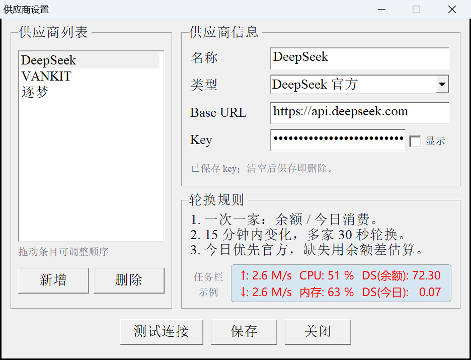

# TrafficMonitor AI Balance —— 任务栏 AI 余额插件

在 TrafficMonitor 任务栏显示一家 AI 服务商的余额和今日消费。


## 功能

- 任务栏两行：第一行余额，第二行今日消费
- 一次显示一家；15 分钟内余额有变化的多家供应商每 30 秒轮换
- 支持 Sub2API、DeepSeek、Kimi、One-API
- 支持千问 Token Plan 和小米 Token Plan 用量：第一行剩余百分比，第二行本周或本月已用百分比
- 今日消费按余额下降累计（账户级），接口报的今日用量按 key 统计、只当下限兜底；DeepSeek、Kimi 只有余额差
- 内置供应商管理：新增、编辑、删除、拖动排序、测试连接、保存；列表里每家名称后面带当前数值，一处看全所有供应商；窗口已开着时再双击，会把它带到前台
- Key 和 Cookie 使用 Windows DPAPI 加密，仅当前 Windows 用户可解密

## 安装

**环境**：Windows 10/11 x64，TrafficMonitor 1.86 x64。

1. 从 [Releases](https://github.com/StephenBoyMi/trafficmonitor-ai-balance/releases/latest) 下载 `AIBalance-v*.zip`。
2. 关闭 TrafficMonitor。
3. 把 `native\AIBalanceNative.dll` 和 `native\AIBalanceNative.ini` 放入 TrafficMonitor 的 `plugins` 目录。
4. 启动 TrafficMonitor，在“显示设置”中勾选 **AI 余额** 和 **AI 今日消费**。
5. 双击任务栏余额项，新增供应商，填写类型、站点地址和 API Key，先“测试连接”，再“保存”。

保存后最多 30 秒，任务栏显示余额。安装目录需要可写；如果 `plugins` 不可写，在 `AIBalanceNative.ini` 的 `[paths]` 中设置 `providers` 和 `log` 的可写绝对路径。



## 支持的供应商

| 类型 | 余额 | 今日消费 |
|---|---|---|
| Sub2API | `balance` / `remaining` | 余额下降累计，官方 `usage.today.actual_cost` 兜底 |
| DeepSeek 官方 | `balance_infos[].total_balance` | 余额下降估算 |
| Kimi / Moonshot 官方 | `data.available_balance` | 余额下降估算 |
| One-API / New-API | `hard_limit_usd - total_usage / 100` | 余额下降累计，官方当天用量兜底 |
| 千问 Token Plan 个人版 | 100% − 周期已用比例 | 官方周期已用比例 |
| 小米 Token Plan | 100% − 本月已用比例 | 官方本月已用比例 |

Token Plan 没有金额余额，两行都按百分比显示，第二行的周期取接口返回：有 `per1WeekPercentage` 显示“本周”，否则显示“本月”。小米 Token Plan 只有月度字段，第二行固定“本月”。

Sub2API 和 One-API 的当天用量按 key 统计，余额是账户级的：同一个账户下用多把 key 时，接口报的“今日”只覆盖其中一把。所以今日消费默认按余额下降累计，接口报的值只当“至少花了这么多”的下限，两者取大——多 key 时由余额差说话，插件漏看一段时由官方值兜底。

## 显示规则

1. 余额变化超过 `0.0000005` 视为刚刚变化。
2. 只显示一家；15 分钟内余额有变化的多家按最近变化排序，每 30 秒轮换。
3. 15 分钟内没有变化时，继续显示最近变化的一家。
4. DeepSeek、Kimi 的今日消费按当天余额下降累加，充值不冲减，跨天归零。
5. 查询失败保留上次成功的显示；查询线程 15 分钟未完成刷新时显示 `--`。
6. Token Plan 用百分比代替金额，且不使用余额差估算。

### 缩写

`DeepSeek` → `DS`，`VANKIT` → `VK`，`逐梦` → `ZM`，`Kimi` / `Moonshot` → `KM`，`One-API` / `New-API` → `OA`，`千问` / `Qwen` / `Token Plan` → `QW`，`小米` / `MiMo` → `MI`；其他名称取英文首字母或前两个汉字。金额保留两位小数，并按整数位宽补空格对齐。

## 供应商管理

- 双击任务栏余额项，或点击 TrafficMonitor 插件管理器中的“选项”
- 可编辑名称、类型、Base URL、Key
- Key 默认用 U+2022 小圆点遮挡，勾选“显示”查看明文
- “测试连接”返回真实接口结果
- 保存后查询立即重载
- Esc 或“关闭”退出；未保存不写文件

### Cookie 类型（千问 / 小米）

这两个平台的用量接口都只认浏览器登录状态，不提供 API Key 查询，所以要把 Cookie 交给插件。千问在 `platform.qianwenai.com`，小米在 `platform.xiaomimimo.com`：

1. 用浏览器登录 `https://platform.qianwenai.com`。
2. F12 打开开发者工具，切到“网络”，刷新用量页：千问任选一条 `data/api.json` 请求，小米选 `/api/v1/tokenPlan/usage`。
3. 在“请求标头”中复制 `cookie:` 后面的整行内容。
4. 类型选“千问 Token Plan（Cookie）”或“小米 Token Plan（Cookie）”，Base URL 显示灰色“留空”，在 Key/Cookie 里粘贴这行 Cookie，先“测试连接”，再“保存”。

登录态到期后接口会返回未登录，界面提示“Cookie 已失效，请重新登录后复制”。千问的会话到期时间会写进 `native.log`（“Token Plan 登录会话到期 …”）。到期后在浏览器重新登录、再复制一次 Cookie 即可。插件不读取浏览器数据，也不自动续期。

### 刷新间隔

在 `AIBalanceNative.ini` 的 `[settings]` 中设置 `refresh`，单位为秒，最小 30。

## 数据与安全

默认数据文件位于 DLL 同目录：

| 文件 | 内容 |
|---|---|
| `providers.json` | 供应商配置和 DPAPI 加密的 Key / Cookie |
| `native.log` | 查询日志，超过 1 MB 轮转 |
| `balances.txt` | 最近一次两行显示文本 |
| `bridge-state.txt` | 上次余额、变化时间和今日消费基准 |

Key 和 Cookie 只以 DPAPI 密文保存在本机，绑定当前 Windows 用户。仓库和发布包不包含 `providers.json`、Key、Cookie、日志或余额数据。

## 插件信息

- 名称：TrafficMonitor AI Balance
- 作者：StephenBoyMi
- 版本：2.2.3
- 链接：https://github.com/StephenBoyMi/trafficmonitor-ai-balance

## 从源码构建

源码在 `native/`，需要带 `windres` 的 MinGW-w64。也可以直接运行 `native\build_mingw.bat`。

```text
windres AIBalanceNative.rc -O coff -o AIBalanceNative.res.o
g++ -std=c++17 -O2 -shared -static-libgcc -static-libstdc++ ^
  -o AIBalanceNative.dll AIBalanceNative.cpp OptionsDialog.cpp Json.cpp Http.cpp ^
  AIBalanceNative.res.o ^
  -lwinhttp -lcrypt32 -lshell32 -luser32 -lgdi32 -lole32 -lcomctl32
```

## 致谢与许可证

- 插件接口头文件来自 [TrafficMonitor](https://github.com/zhongyang219/TrafficMonitor)，版权归 Zhong Yang；详见 [THIRD_PARTY_NOTICES.md](THIRD_PARTY_NOTICES.md)。
- 本项目以 MIT 许可证发布，详见 [LICENSE](LICENSE)。
